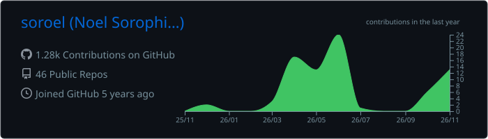
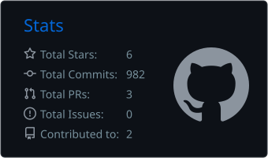

<!-- Animated Typing Header -->

  

  <strong>Software Engineer • Data Science • Strategic AI • Innovation</strong>

---

### About Me

I’m a software engineer with a strong interest in **turning data into decisions and ideas into products**. I’m especially drawn to the intersection of **engineering, data science, AI strategy, and innovation** — building solutions that are both technically strong and meaningful in the real world.

- **Currently building:** Scalable software & AI-driven products
- **Focus areas:** Applied Machine Learning, Data Architecture & Product Strategy
- **Philosophy:** Great technology bridges solid engineering with real human impact
- **Open to collaborating on:** AI systems, data pipelines and innovative product builds

---

  
   

  
   
  
  

---

### 🛠️ Core Stack & Domains

**Languages & Engineering**  
 

**Data Science & AI**  
 

---

### 📌 Featured Focus

| Domain | What I Do |
| :--- | :--- |
| **Software Engineering** | Architecting reliable, maintainable applications and APIs from prototype to production. |
| **Data Science** | Extracting actionable insights through exploratory analysis, modeling, and data pipelines. |
| **Strategic AI** | Aligning AI capabilities with business goals to solve high-leverage real-world problems. |

---

### 🌐 Connect With Me

  
  
  

